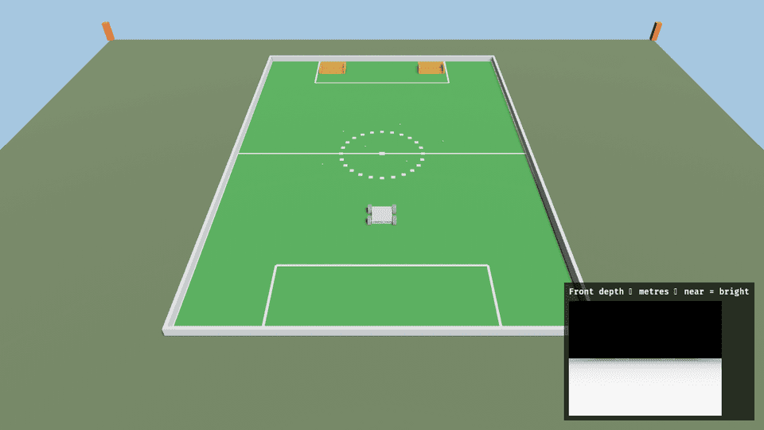

# Zorvane

Docs: <https://super-yojan.dev/Zorvane/>.
Part of <https://super-yojan.dev>.
Fleet operator: [ARGOS](https://super-yojan.dev/ARGOS/).
Vehicle body: [Terra](https://super-yojan.dev/Terra/).

Zorvane is the NEXT competition simulator. It runs the NEXT 2026 field on
Field 3, West Campus, George Mason University, at its real latitude and
longitude, with CrabTrapBot as the rover. It speaks the same Zenoh topics and
WebRTC video as a real Terra rover, so a dashboard built against Zorvane works
against the fleet. Terra is the vehicle body. ARGOS is the fleet operator.



*The rules, the field and the controls: [simulator/NEXT.md](simulator/NEXT.md).*

## Download

Builds for macOS, Windows and Linux are on the
[releases page](https://github.com/Super-Yojan/Zorvane/releases). Unzip and run
`zorvane`; the intro cutscene explains the game. The simulator listens on
`tcp/127.0.0.1:7447` with prefix `terra/rover`.

## Build from source

Rust 1.85 or newer, Git LFS, and a sibling `Terra` checkout at the revision in
[`terra-source.json`](terra-source.json):

```sh
git lfs pull
cargo run --locked -p zorvane
```

`TERRA_ZENOH=0` turns the bridge off and puts rover 0 on W/A/S/D.
`TERRA_HEADLESS=1` runs without a window. Dimensions and sources are in
[SCALE.md](SCALE.md); rover bodies in [VEHICLES.md](VEHICLES.md).

## Zenoh topics

`P` below is the topic prefix: `terra/rover` by default, overridden with
`TERRA_ZENOH_PREFIX` (for example, `terra/phone` for the hosted ARGOS setup).
`<id>` is the rover ID, starting at `0`. Directions are from Zorvane's perspective.
`TERRA_ZENOH=0` disables the bridge and allows W/A/S/D driving. The full guide,
with the teleop binding and the FPV handshake, is [simulator/ZENOH.md](simulator/ZENOH.md).

### Subscribes / receives

| Topic | Purpose |
| --- | --- |
| `P/fleet/size` | Set rover count: `{"count": 1}` (0–32). |
| `P/<id>/teleop` | Drive: a twist bound to the current run and authority revision. |
| `P/<id>/next/load` | NEXT: move one waiting ball into the dumper. |
| `P/<id>/next/dump` | NEXT: dump the dumper into the bucket ahead. |
| `P/<id>/webrtc/request`, `answer`, `ice/dashboard` | FPV video signaling (Terra `fpv-signaling`). |
| `P/<id>/hardware` | Arm or disarm. |
| `P/<id>/navigation/settings`, `source`, `resume` | Navigation configuration. |
| `P/<id>/autonomy` | Select autonomy level. |
| `P/<id>/safety` | Safety request. |
| `P/<id>/goal` | Set or cancel a waypoint goal. |
| `P/<id>/goal/decision` | Respond to a proposed goal. |
| `P/<id>/search` | Start a search. |
| `P/<id>/search/action` | Control an existing search. |
| `P/<id>/search/report/ack` | Acknowledge a search report. |
| `P/<id>/mission/report` | Report a survivor using `survivor_id`. |

The native transport subscribes to `P/**`; the
[receive handler](simulator/src/bridge.rs) dispatches only the incoming topics
listed above. Payloads are JSON; messages larger than 2,048 bytes are ignored.
Per-rover commands require an active rover ID. A teleop command expires after
500 ms; refresh it at 10–20 Hz and send zeros to stop.

### Publishes

| Topic | Contents |
| --- | --- |
| `P/fleet/state` | Rover count, maximum count, and active IDs. |
| `P/<id>/pose` | Robotics-frame position and heading. |
| `P/<id>/next/status` | NEXT: alliance, ball counts, load and dump readiness. |
| `P/next/score` | NEXT: points per alliance. |
| `P/<id>/localization` | Geographic origin of the field frame (Field 3). |
| `P/<id>/navigation/outdoor` | Simulated GPS and outdoor navigation state. |
| `P/<id>/webrtc/offer`, `ice/phone`, `state` | FPV video signaling. |
| `P/<id>/camera/rgb` | RGB camera frame: RGBA8 sRGB pixels. |
| `P/<id>/camera/depth` | Depth frame: little-endian float32 metres, with exposure pose metadata. |
| `P/<id>/map/occupancy` | Full occupancy-map snapshot. |
| `P/<id>/map/occupancy/heartbeat` | Map baseline identifiers without resending the grid. |
| `P/<id>/hardware/status` | Simulated actuator readiness and arming state. |
| `P/<id>/autonomy/status` | Autonomy state, including route when available. |
| `P/<id>/goal/status` | Waypoint execution status. |
| `P/<id>/goal/proposal` | Proposed goal. |
| `P/<id>/search/status` | Search state. |
| `P/<id>/search/report` | Pending search reports. |
| `P/<id>/mission/status` | Mission state. |
| `P/<id>/experiment/status` | Run ID, elapsed time, and recording health. |

Outgoing payloads use `application/json`, except camera frames, which use
`application/octet-stream`: a JSON header followed by a newline and raw pixels.

Default publication timing:

- Pose and cameras: up to 10 Hz; cameras require a new frame.
- Fleet state: on membership changes and approximately every second.
- Goal, autonomy, hardware, search, mission, and experiment status, goal proposals,
  and pending search reports: approximately 5 Hz, also on controller resets.
- Occupancy: full snapshots when fresh source data changes the map or its run
  identity, or when the previous full snapshot is at least two seconds old.
  Unchanged maps can emit heartbeats at up to 5 Hz. Both require fresh, advancing
  source frames.

The [native transport](simulator/src/native_bridge.rs) publishes to the local
session and the optional fleet session. Zorvane does not publish `pointcloud`.

### Payload structures

These contracts match the Terra revision pinned above. Coordinates are metres
in the robotics frame: `x = -Bevy Z`, `y = -Bevy X`, and `z = Bevy Y` (up).
Yaw and angular velocity use radians and radians/second; positive yaw turns
from +x toward +y. Linear velocity is metres/second. JSON integers used as IDs,
sequences, or revisions are nonnegative. Tokens are request correlation IDs,
not credentials: 1–64 ASCII letters, digits, or `._:-`.

#### Incoming JSON examples

Each object below is the complete message body for its topic. Replace run,
search, proposal, and report IDs with IDs from current telemetry. Successful
decoding alone does not authorize motion; autonomy and safety state still apply.

| Topic suffix | Example body |
| --- | --- |
| `fleet/size` | `{"count":1}` |
| `<id>/next/load`, `<id>/next/dump` | `{}` (the body is ignored) |
| `<id>/teleop` | `{"linear":1.0,"angular":0.25,"run_id":"run-123","authority_revision":2,"operator_session_id":"operator-1","sequence":1}` |
| `<id>/autonomy` | `{"level":"waypoint","token":"level-1"}` |
| `<id>/safety` | `{"action":"stop","token":"stop-1"}` |
| `<id>/goal` (local) | `{"frame":"local","x":5.0,"y":2.0,"yaw":0.0,"token":"goal-1"}` |
| `<id>/goal` (geographic) | `{"frame":"wgs84","latitude":38.83,"longitude":-77.31,"token":"goal-2"}` |
| `<id>/goal` (cancel) | `{"cancel":true}` |
| `<id>/goal/decision` | `{"run_id":"run-123","proposal_id":1,"decision":"approve","token":"decision-1"}` |
| `<id>/search` | `{"version":1,"run_id":"run-123","search_id":"search-1","token":"start-1","target_class":"survivor","bounds":{"min_x":-10.0,"min_y":-10.0,"max_x":10.0,"max_y":10.0},"time_budget_s":300.0}` |
| `<id>/search/action` | `{"version":1,"run_id":"run-123","search_id":"search-1","token":"pause-1","action":"pause"}` |
| `<id>/search/report/ack` | `{"version":1,"run_id":"run-123","search_id":"search-1","report_id":"report-1","token":"ack-1"}` |
| `<id>/mission/report` | `{"survivor_id":1}` |

- `teleop`: bind every command to `run_id` and `revision` from the rover's
  `autonomy/status`, as `run_id` and `authority_revision`, and increase
  `sequence` each time. Both velocities must be finite and within −5 through +5.
- `autonomy.level`: `teleop`, `assisted_teleop`, `waypoint`, `waypoint_direct`,
  `supervised`, or `target_search`.
- `safety.action`: `stop` or `reset`.
- `goal`: `yaw` and `token` are optional. Yaw must be within ±2π. Geographic
  latitude must be within ±85°, longitude within ±180°; geographic goals need
  a configured origin. Local goals must also fit the active world's bounds.
  Cancellation accepts only `{"cancel":true}`.
- `goal/decision.decision`: `approve`, `reject`, or `resume`. Approve/reject
  require `proposal_id`; resume requires it to be omitted or `null`.
- Search messages require `version: 1`. Search actions are `pause`, `resume`,
  or `cancel`. Bounds must have positive width/height, each at most 100 m;
  `time_budget_s` must be greater than 0 and at most 3,600. Target classes use
  1–64 ASCII letters, digits, `_`, or `-`. Report IDs allow 1–128 ASCII letters,
  digits, or `._:-`.

#### Outgoing JSON fields

In the schemas below, `T?` means a JSON value of type `T` or `null`, `T[]`
means an array, and `int` means an integer. Nullable fields are emitted as
`null` unless explicitly described as omitted. A topic can carry `null` as its
entire body where indicated.

```text
fleet/state:
  {count:int, max_count:int, ids:int[]}

<id>/pose:
  {x:number, y:number, yaw:number, heading:number}
  heading equals yaw.

<id>/map/occupancy:
  {schema_version:1, rover_id:int, run_id:string, sequence:int,
   width:int, height:int, resolution:number, origin_x:number, origin_y:number,
   occupancy:int[]}
  resolution is metres/cell. occupancy has width*height entries, indexed
  row*width+column; columns increase in +x and rows in +y. Values are -1
  (unknown) or 0..100 (occupancy probability). Cell (column,row) has centre
  (origin_x+(column+0.5)*resolution, origin_y+(row+0.5)*resolution).

<id>/map/occupancy/heartbeat:
  {schema_version:1, rover_id:int, run_id:string, sequence:int}
  Identifies the last full snapshot baseline, not a new grid.

<id>/hardware/status:
  {schema_version:1, run_id:string, control_mode:"streamed_relay",
   connected:boolean, ready:boolean, output_active:boolean, fault:null,
   simulated:true, reason:string, armed:boolean}

<id>/next/status:
  {schema_version:1, alliance:"red"|"blue", target_bucket:"orange"|"blue",
   state:string, collected:int, waiting:int, dumper:int, capacity:int,
   dumper_capacity:int, can_load:boolean, can_dump:boolean}

next/score:
  {schema_version:1, red:int, blue:int}

<id>/localization:
  {version:1, mode:"geographic", originLatitude:number,
   originLongitude:number, anchorX:0, anchorY:0, rotation:number,
   simulated:true}

<id>/goal/status:
  {state:"idle"|"active"|"arrived", goal_id:int, distance:number,
   x:number, y:number, token?:string, yaw?:number,
   latitude?:number, longitude?:number}
  Here field-name '?' means omitted when absent, rather than emitted as null.
  distance is metres; latitude/longitude are degrees.

<id>/goal/proposal:
  null, or
  {run_id:string, proposal_id:int, x:number, y:number, map_revision:int,
   expires_at:number, reason:string}

<id>/autonomy/status:
  {run_id:string, assigned_level:Level?, requested_level:Level,
   effective_level:Level?, active_source:string, safety:string, reason:string,
   revision:int, token:string?, result:string?, request_reason:string?,
   supported_levels:Level[], paused:boolean,
   global_route?:[number,number][], planner_trace?:PlannerTrace}
  Level is one of the autonomy.level strings above. global_route contains
  world [x,y] points and is omitted when empty; planner_trace is omitted
  when unavailable.

PlannerTrace:
  {age:number, origin:{x:number,y:number,yaw:number},
   candidates:CandidateTrace[], selected:int?}
  age is seconds; selected is an index into candidates.

CandidateTrace:
  {velocity:{linear:number,angular:number}, points_mm:[int,int][],
   rejection:string?}
  points_mm are millimetre offsets from PlannerTrace.origin in world axes.

<id>/search/status:
  null, or
  {target_class:string, version:1, run_id:string, search_id:string,
   revision:int, phase:SearchPhase, reason:string, elapsed_s:number,
   active_goal:[number,number]?, report:SearchReport?,
   detector_available:boolean, token:string?, result:string?}
  SearchPhase is searching, confirming, completed, paused, needs_attention,
  cancelled, timed_out, or exhausted. active_goal is world [x,y].

<id>/search/report (SearchReport):
  {version:1, report_id:string, run_id:string, search_id:string,
   target_class:string, world_x:number, world_y:number, confirmed_at:number,
   frame_ids:int[], evidence_ids:string[]}

<id>/mission/status:
  {mission_id:string, objective:string, seed:int, phase:string,
   confirmed:int, required:int, remaining_seconds:number, half_extent:number,
   complete:boolean, failed:boolean, observations:Sighting[]}

Sighting:
  {survivor_id:int, x:number, y:number, rover_id:int,
   observed_at:number, confirmed:boolean}

<id>/experiment/status:
  {run_id:string, schema_version:1, run_elapsed:number, utc:number,
   recording:boolean}
  run_elapsed is seconds since the autonomy runtime started; utc is Unix
  time in seconds. recording reflects combined runtime/recorder health.
```

`expires_at`, `confirmed_at`, and `observed_at` use the autonomy runtime's
elapsed-seconds clock, not Unix time. Consumers should tolerate additional
telemetry fields when updating the pinned runtime.

#### Camera binary layout

Split the packet at its **first newline byte**. Decode the preceding bytes as
UTF-8 JSON; all remaining bytes are raw image data, which may themselves contain
newline bytes. Both image types have exactly `width * height * 4` pixel bytes.

```text
JSON header + 0x0A + raw pixel bytes

Header:
  {rover_id:int, version:1, width:int, height:int, sequence:int,
   received_at:number, encoding:string, vertical_fov:number,
   near:number, far:number,
   exposure_time?:number,
   camera?:{x:number,y:number,z:number,qx:number,qy:number,qz:number,qw:number},
   body?:{x:number,y:number,yaw:number}}
```

- RGB encoding is `RGBA8_SRGB`: row-major RGBA bytes, shape `(height,width,4)`.
- Depth encoding is `32FC1_LE`: row-major little-endian float32 metres,
  shape `(height,width)`. Depth measures distance along optical +z rather than
  Euclidean ray length. NaN means no return.
- `vertical_fov` is radians; `near` and `far` are metres. `received_at` is
  simulation elapsed time in seconds, not Unix time or autonomy run time.
- Depth can include `exposure_time`, `camera`, and `body`, sampled at exposure
  time. Those fields are omitted when unavailable and on RGB packets.
  `camera` is the optical-camera pose in robotics world coordinates; its
  quaternion maps optical axes (+x right, +y down, +z forward) into that world.

Shared request/status definitions are maintained in the pinned Terra crates:
[autonomy contracts](https://github.com/Super-Yojan/Terra/blob/4b582677386b8ed7d5e430585572b83011ea7fc4/crates/terra-autonomy/src/contract.rs),
[search contracts](https://github.com/Super-Yojan/Terra/blob/4b582677386b8ed7d5e430585572b83011ea7fc4/crates/terra-autonomy/src/search_contract.rs),
and [waypoint contracts](https://github.com/Super-Yojan/Terra/blob/4b582677386b8ed7d5e430585572b83011ea7fc4/crates/terra-waypoint/src/lib.rs).
Zorvane's [bridge](simulator/src/bridge.rs) defines the camera headers and
simulator-specific telemetry.

## Test

```sh
cargo test --locked --workspace
python3 -m pip install -r simulator/tools/requirements.txt
python3 -m unittest discover -s simulator/tools -p 'test_*.py'
```

GPU render tests are `#[ignore]`.

## Layout

- `simulator/` — Bevy/Avian world, cameras, occupancy, FPV video, Zenoh bridge. Binary name: `zorvane`.
- `crates/zorvane-vehicle/` — the body seam: `TerraGround` and `CrabTrapBot`.
- `docs/` — the documentation site, an Astro project published at <https://super-yojan.dev/Zorvane/>.
- Shared crates (`terra-types`, `terra-control`, `terra-waypoint`, `terra-transport`, and the autonomy stack) stay in Terra. TerraPhone still compiles them there.
