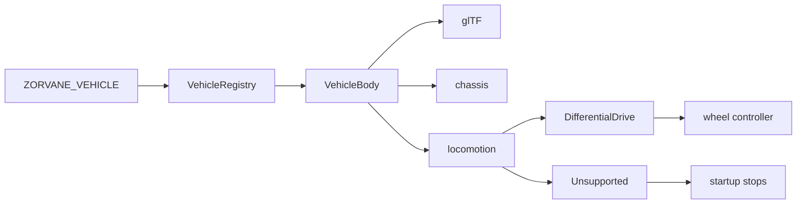

# Vehicle bodies

**TL;DR.** `ZORVANE_VEHICLE` picks a registered body. The default is `crab-trap-bot`, the NEXT rover. The field and the Zenoh keys stay shared.



*Differential drive becomes wheel speeds. Anything else stops the process and prints the reason.*

Zorvane spawns the selected body. Chassis size, wheel geometry, and the mesh come from that body.

## Seam

`zorvane-vehicle::VehicleBody` is the plug-in:

| Method | What the world uses it for |
| --- | --- |
| `id` | `ZORVANE_VEHICLE` selection key |
| `display_name` | Entity name prefix (`Terra 0` for the built-in body) |
| `visual` | glTF path under the asset root |
| `chassis` | Avian cuboid, mass, visual scale |
| `locomotion` | How a velocity request becomes motion |

`VehicleRegistry` holds the bodies registered in this build. `from_env` reads
`ZORVANE_VEHICLE` and defaults to `terra-ground`. An unknown id fails at
startup and lists the ids that were registered.

The simulator turns a `DifferentialDrive` body into `DriveConfig` and
`RoverPhysicsConfig`, then the existing wheel controller, force controller,
cameras, and Zenoh bridge run as they did in Terra. A body whose locomotion is
`Unsupported` can be registered and selected, and startup refuses to drive it.
That is the hole a drone or a #22 import fills later: add a variant or a real
actuator model, register the body, and teach the drive systems to apply it.
Do not fork the town, the tile world, or the Zenoh key layout per vehicle.

## CrabTrapBot preview

Select the updated CAD body in a native window with:

```sh
ZORVANE_VEHICLE=crab-trap-bot TERRA_ZENOH=0 cargo run -p zorvane
```

`CrabTrapBot.step` uses millimetres. The STEP source (147 MB) and its original
conversion (`CrabTrapBot_raw.glb`, about 1.6 GB and 27.6 million triangles)
are kept locally and excluded from Git; the raw GLB can exhaust the graphics
device when the world loads. The selectable body uses
`simulator/assets/models/crab_trap_bot_sim.glb`, a centered 19 MB visual
with about 550,000 triangles. The visual is rotated 90° clockwise from above
so the intake faces local −Z, then scaled by 0.001 to metres. Its dimensions
are about 0.607 × 0.614 × 0.601 m. The simulated collision frame has an open
front; in NEXT, simplified inward-swinging flap visuals and a one-way collection
rule hold tennis balls. Wheel radius (72 mm, goBILDA 144 mm wheels) and track
width (52.6 cm between tyre centres) come from the Fusion assembly. Its four
wheels skid-steer, so the effective turning track on the real rover is wider
than the geometric one. The motor limit and mass are still provisional until
measured on the hardware; the motor limit keeps Terra's ~2.29 m/s linear cap. The visual mesh does not provide wheel joints or collision
geometry.

The optimized GLB was made with `gltfpack -si 0.02 -se 0.02 -sp -noq` and
recentered by its mesh bounds. `-noq` avoids `KHR_mesh_quantization`, which the
current Bevy glTF loader rejects. The simulator loads it from
`simulator/assets/models/`, or from the release's bundled `assets/`.

## Terra ground rover

`TerraGround` (`id = terra-ground`) is the chassis extracted from Terra's
simulator:

- asset `simulator/assets/models/rover.glb` (Git LFS), a Blender glTF of the CAD model, in centimetres
- cuboid 0.403 m × 0.144 m × 0.384 m (the mesh bounds × 0.01), 20 kg, visual scale 0.01
- wheel radius 0.045 m, track 0.350 m, wheel limit 50.8 rad/s (about 2.3 m/s)

Mass and the wheel-speed limit are not on the mesh. Sources and the numbers that are still unsourced are in [SCALE.md](SCALE.md).

Those numbers used to be `DriveConfig::default` and `RoverPhysicsConfig::default`
inside the simulator. Both defaults now read `TerraGround`, so tests and an
unset `ZORVANE_VEHICLE` keep the same rover.

Terra's hardware crates (`terra-motors`, `terra-actuators`) stay in the Terra
repo. They are the Pi and phone actuator path, not this collider. Zorvane
depends on the shared crates the bridge already called (`terra-waypoint`,
`terra-control`, `terra-transport`, mapping, autonomy) via git, pinned to Terra
commit `d0c34872e70cfe05750eef0662c4d8a58cd51889`.

## Add a body

Implement `VehicleBody` and register the value in `VehicleRegistry::from_id`
before `select`. `from_env` reads `ZORVANE_VEHICLE` and defaults to
`terra-ground`. `from_id` registers `TerraGround` and `CrabTrapBot`. An id that
was not registered fails at startup with the list of ids that were.

The visual path is relative to the asset root (`simulator/assets`, or
`ZORVANE_ASSETS`). Put the glTF there. The chassis box is metres in the
simulator frame: X right, Y up, Z depth. Differential drive treats local −Z as
forward.

```rust
use zorvane_vehicle::{
    ChassisSpec, DifferentialDriveSpec, Locomotion, VehicleBody, VehicleVisual,
};

struct ExampleRover;

impl VehicleBody for ExampleRover {
    fn id(&self) -> &'static str {
        "example-rover"
    }

    fn display_name(&self) -> &'static str {
        "Example"
    }

    fn visual(&self) -> VehicleVisual {
        VehicleVisual {
            asset_path: "models/example.glb",
        }
    }

    fn chassis(&self) -> ChassisSpec {
        ChassisSpec {
            size_xyz: [0.9, 0.16, 0.8],
            mass_kg: 20.0,
            visual_scale: 1.0,
        }
    }

    fn locomotion(&self) -> Locomotion {
        Locomotion::DifferentialDrive(DifferentialDriveSpec {
            wheel_radius_m: 0.15,
            track_width_m: 0.6,
            max_wheel_speed_rad_s: 20.0,
            keyboard_linear_speed: 1.5,
            keyboard_angular_speed: 1.5,
        })
    }
}
```

`main` turns the active body into `DriveConfig` and `RoverPhysicsConfig`. A
differential-drive body uses the existing wheel controller, cameras, and Zenoh
bridge. Size, mass, and visual scale must be finite and positive. Wheel radius,
track width, and the wheel speed limit must be finite and positive.

`Locomotion::Unsupported { reason }` is the hole for a body this build cannot
actuate. The registry accepts it. `DriveConfig::from_body` returns `reason`,
and the process aborts with `vehicle '<id>' cannot be driven by this Zorvane
build: <reason>`. The unit test `placeholder-drone` uses that variant and is
not registered for `ZORVANE_VEHICLE`. A later drone, or a Terra import, adds a
locomotion variant or a real actuator model, registers the body, and teaches
the drive systems to apply it. Leave the town, the tile world, and the
`terra/rover` keys shared.

## Not in this repo

Terra #22, easy robot import with flexible actuators, is a separate project.
The registry is the place that work should attach. This extraction does not
load URDF, invent actuator graphs, or simulate a drone.

## Zenoh

Keys stay on the prefix `terra/rover` (override with `TERRA_ZENOH_PREFIX`).
TerraPhone publishes `terra/rover/<id>/cmd_vel` and subscribes to
`terra/rover/<id>/camera/depth`. ARGOS uses the same prefix for `goal`,
`goal/status`, `fleet/state`, and depth. Nothing in those paths was renamed.
Fleet size is still `TERRA_ROVER_COUNT` and `terra/rover/fleet/size`.
