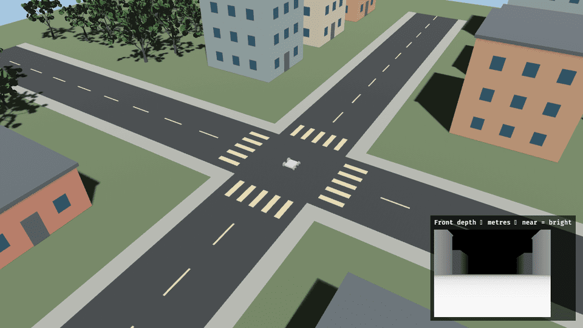

# Running

Run a client on this computer. It prints a pairing URL. Open that URL in Chrome or Edge, choose a world, and press **Start**.



*The world the pairing URL opens.*

## Python

```sh
python3 -m pip install -e clients/python
python3 -m zorvane
```

## Rust

Rust 1.85 or newer.

```sh
cargo run -p zorvane-client --example print_pose
```

## Drive

`heading` and `yaw` are the same angle in radians. Publish velocity at least every 500 ms. Send zeros to stop. The rover also stops while the simulator tab is hidden.

```python
import time
import zorvane

client = zorvane.connect()
client.wait_connected(120)
deadline = time.time() + 3
while time.time() < deadline:
    client.set_velocity(0, 0.4, 0.0)
    time.sleep(0.05)
client.set_velocity(0, 0.0, 0.0)
```

The Rust client has the same calls. See [Browser client](browser-client.md) and [Python client](python-client.md).

The pairing URL depends on the browser simulator build being available. If the page is unavailable, follow the [native setup](dev/native-zenoh.md) or inspect the browser deployment before retrying.
