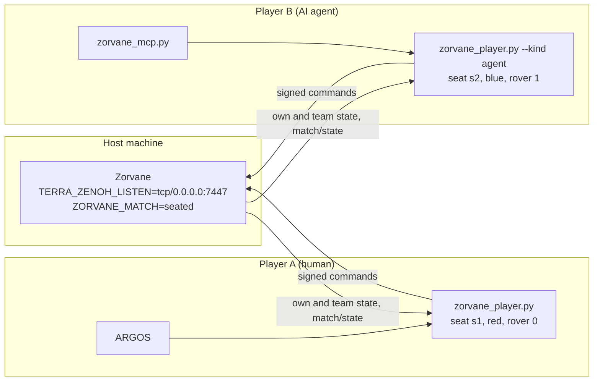
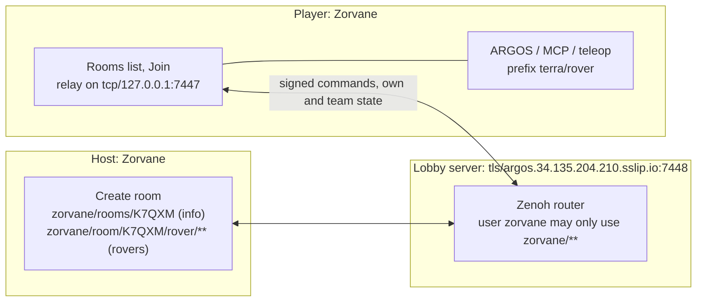

# Multiplayer: players on other computers

**TL;DR.** One machine hosts the simulator. Every player runs
[`tools/zorvane_player.py`](tools/zorvane_player.py) on their own machine. The
relay joins the match, gets a seat (a secret and the rovers that player drives),
and opens a local Zenoh endpoint. ARGOS, `zenoh_client.py` and the zorvane MCP
server connect to that local endpoint without any change. AI agents join the same
way as people, with `--kind agent`.



*Commands are signed per seat. The host drops any command for a rover that is
not the sender's.*

## Online rooms (Play online)

The easiest way. Everyone signs in to the same lobby server (the ARGOS GCP
router by default), one player creates a room, and the others pick it from a
list and join with the room password. No ports to open, no Python.



1. Start menu, **Play online**. Fill in the server, user (`zorvane`), the
   server password and your name, then **Connect**. They are saved to
   `online.json` (`~/Library/Application Support/Zorvane/` on macOS,
   `%APPDATA%\Zorvane\` on Windows, `~/.config/zorvane/` on Linux, mode 0600).
2. Host: **Create room**, give it a name and an optional room password. The host
   gets a 5-letter room code and a seat on the chosen team; the chip at the bottom
   left has **Start match** / **Reset match**, and Esc then **Close room** ends it.
3. Player: pick the room in the list (code, host, phase, free red/blue rovers,
   players), type the room password, pick a team, **Join**. The game shows your
   seat, rovers and round trip. Point ARGOS, the MCP server or `zenoh_client.py`
   at `tcp/127.0.0.1:7447` with prefix `terra/rover`, as for a local sim.

There are two passwords. The **server password** keeps strangers off the lobby
server (see the ARGOS `packaging/gcp/README.md`, account `zorvane`). The **room
password** is checked by the hosting game before it gives out a seat. A wrong
one shows "Wrong room password".

Without a window, or for agents:

```sh
# Host a room
ZORVANE_SERVER_PASSWORD=… ZORVANE_ROOM="Friday match" ZORVANE_ROOM_PASSWORD=field3 cargo run -p zorvane
# Join a room from the game, headless (its relay serves tcp/127.0.0.1:7447)
ZORVANE_SERVER_PASSWORD=… ZORVANE_JOIN=K7QXM ZORVANE_ROOM_PASSWORD=field3 ZORVANE_TEAM=blue TERRA_HEADLESS=1 cargo run -p zorvane
# Or with Python
python3 tools/zorvane_player.py --password … rooms
python3 tools/zorvane_player.py --password … --room K7QXM --code field3 --team blue --kind agent
```

| Variable | Meaning |
| --- | --- |
| `ZORVANE_SERVER` | Lobby server endpoint, default `tls/argos.34.135.204.210.sslip.io:7448` |
| `ZORVANE_SERVER_USER`, `ZORVANE_SERVER_PASSWORD` | Server sign-in, default user `zorvane` |
| `ZORVANE_ROOM`, `ZORVANE_ROOM_PASSWORD`, `ZORVANE_ROOM_CODE` | Host a room at startup (code is random if unset) |
| `ZORVANE_JOIN`, `ZORVANE_TEAM` | Join a room at startup, headless |

The host's key is still printed at startup, so `zorvane_player.py --room CODE
control start --host-key KEY` starts a headless host's match.

For your own server, run `cargo run -p zorvane-lobby -- --listen tls/0.0.0.0:7448
--config router.json5`, a plain Zenoh router that also logs rooms opening and
closing. Give it a `transport/auth/usrpwd` dictionary and the same
`access_control` block the ARGOS installer writes.

Not yet: FPV video across rooms (WebRTC signaling only runs on the local
session), and room spectators. Any signed-in user can read a room's state;
only seated players can drive.

## Host

```sh
TERRA_ZENOH_LISTEN=tcp/0.0.0.0:7447 ZORVANE_MATCH=seated ZORVANE_JOIN_CODE=field3 \
TERRA_ROVER_COUNT=4 cargo run --release -p zorvane
```

In a windowed host the start menu has the same choices: set **Who can connect**
to *Other computers too*, **Multiplayer** to *Seated* and **Join code** to *New
code* (the code is shown on the button), then press Start. Zorvane relaunches
with those settings.

Or headless, as a dedicated server: add `TERRA_HEADLESS=1`, or use
[`docker/Dockerfile`](../docker/Dockerfile), which already listens on
`0.0.0.0:7447`. Open TCP 7447 in the host's firewall.

| Variable | Meaning |
| --- | --- |
| `ZORVANE_MATCH` | `open` (default): rovers nobody has claimed take unsigned commands, as before. `seated`: every rover command must come from its seat or the host, and rovers only drive while the match is running. |
| `ZORVANE_JOIN_CODE` | Players must send this code to join. Unset means anyone who reaches the port may join. |
| `ZORVANE_HOST_KEY` | Signs host actions. Random when unset; Zorvane logs it at startup. |
| `ZORVANE_SEAT_TIMEOUT` | Seconds without a signed message before a seat is freed (default 15). The relay sends a heartbeat every 2 s. |

Rovers alternate alliances by slot: rover 0 red, 1 blue, 2 red, and so on. Set
`TERRA_ROVER_COUNT` to the number of rovers you want in the match; joining does
not spawn rovers.

Match control, from the host or any machine with the host key:

```sh
python3 tools/zorvane_player.py --host tcp/192.168.1.20:7447 control start --host-key KEY
python3 tools/zorvane_player.py --host tcp/192.168.1.20:7447 control pause --host-key KEY
python3 tools/zorvane_player.py --host tcp/192.168.1.20:7447 control reset --host-key KEY
python3 tools/zorvane_player.py --host tcp/192.168.1.20:7447 control fleet --count 6 --host-key KEY
```

`start` begins the match clock (and leaves the start menu, in a windowed host).
`pause` and `resume` pause the simulation. `reset` rebuilds the field, clears the
score and puts the match back in the lobby; rover ids start at 0 again, so seats
and `--rover` arguments still fit. `kick` frees every seat. In seated mode the
lobby and paused phases refuse every command except an emergency stop.

## Players

```sh
python3 -m pip install -r tools/requirements.txt
python3 tools/zorvane_player.py --host tcp/192.168.1.20:7447 --name ana --team red --code field3
```

The relay prints the seat and rovers, then a status line every 10 s with the
match phase and the round trip to the host. Then start your client against the
local endpoint, `tcp/127.0.0.1:7447`, which is every tool's default:

- **ARGOS**: connect to `tcp/127.0.0.1:7447` with prefix `terra/rover`.
- **teleop**: `python3 tools/zenoh_client.py --rover 0 drive --linear 0.6 --seconds 3`.
- **AI agent**: run the relay with `--kind agent`, then the MCP server with
  `--rover <your rover>`. The agent appears in `match/state` as `"kind":"agent"`.

| Option | Meaning |
| --- | --- |
| `--team red\|blue` | Alliance. Unset takes the first free rover. |
| `--rovers N\|all\|0,2` | How many rovers, every free rover of the team (one operator, many robots), or ids. `id:1` asks for rover 1 alone. Default 1. |
| `--kind human\|agent` | Shown in `match/state`. |
| `--listen` | Local endpoint for your clients. Use another port if the host runs on this machine. |
| `--see own\|team\|all` | Rovers whose full state crosses the network. Pose and NEXT status of every rover always come. Default `team`. |
| `--frames own\|see\|none` | Camera frames for own rovers, every rover in view, or none. Default `own`. |
| `--user`, `--password`, `--tls-ca` | For a hosted Zenoh router (below). |

## Spectators

People who only watch need no seat. On the host's own screen, start Zorvane
with `ZORVANE_SPECTATOR=1` (or press V) for a free camera that never drives;
see the camera keys in [NEXT.md](NEXT.md). From another computer, run the relay
in watch mode and point ARGOS at it:

```sh
python3 tools/zorvane_player.py --host tcp/192.168.1.20:7447 watch [--frames see]
```

It relays the state of every rover, takes no seat and drops every command, so
a spectator cannot drive anyone's rover. FPV signaling still passes, so the
spectator can open a rover's video. Camera frames stay off unless `--frames see`.

`python3 tools/zorvane_player.py --host … status` prints `match/state` and five
round trips without joining.

If the relay restarts, it joins again. If the host restarts or a seat times out,
the relay asks for the same rovers again.

## Authority

A join is a Zenoh query on `match/join`, so the reply with the seat secret goes
only to the player who asked. Each command then carries a Zenoh attachment
`{"seat":"s1","seq":N,"mac":"…"}`: HMAC-SHA256 of `seat \n seq \n key \n
payload`, keyed by the secret. The host checks the MAC and that `seq` only grows,
so another player who sees the command on the bus can neither forge it, move it
to another rover, nor replay it. The payloads are the unchanged Terra contract.

| Sender | Own rover | Other seat's rover | Unclaimed rover |
| --- | --- | --- | --- |
| Seat | yes (seated: only while running, except stop) | no | no |
| Host key | yes | yes | yes |
| Unsigned | no | no | open mode only |

`fleet/size` and `match/control` need the host key in seated mode. A freed seat's
rovers drop their latched goal; their teleop lease runs out by itself in 0.5 s.

This is enough to stop players driving each other's rovers. It does not hide
traffic: on a plain `tcp/` link anyone on the path can read the join reply. Use
TLS or a VPN when that matters.

## Latency and bandwidth

A teleop command lives 0.5 s, and clients send it at 10 to 20 Hz, so driving
holds up with round trips up to about 200 ms. Each relay status line shows the
round trip, measured against `match/ping`, which Zorvane answers on the network
thread, not the frame loop. The relay adds one local hop (under 1 ms).

Bandwidth is mostly cameras. An RGB and a depth frame are each 256 × 192 × 4
bytes, about 200 KB, at up to 10 Hz: about 4 MB/s (32 Mbit/s) per rover with
both. The relay only subscribes to frames for your own rovers by default; use
`--frames none` over a slow link, and `--see own` to drop teammates' maps. FPV
video is WebRTC, peer to peer, at a far lower rate; across NATs it may need a
TURN server, which Zorvane does not provide.

## Over the internet

Three ways, simplest first:

1. **VPN (Tailscale, ZeroTier, WireGuard).** Put the host and players on one
   tailnet and use the host's tailnet address as `--host`. Nothing else changes,
   and the link is encrypted.
2. **Port forward.** Forward TCP 7447 on the host's router. Set
   `ZORVANE_JOIN_CODE`. Traffic is plain TCP.
3. **Hosted Zenoh router.** Run `zenohd` with TLS and user/password on a server.
   The host connects out to it with `TERRA_ZENOH_CONNECT=tls/router:7447`,
   `TERRA_ZENOH_USER`, `TERRA_ZENOH_PASSWORD` (and `TERRA_ZENOH_LISTEN=` empty if
   it should not listen locally). Players pass the same router as `--host` with
   `--user`, `--password` and `--tls-ca`. Seats work unchanged through the
   router, and no machine needs an open port.

## Topics

`P` is the prefix, `terra/rover` by default.

| Key | Direction | Payload |
| --- | --- | --- |
| `P/match/join` | query | `{"name":"ana","team":"red","rovers":1,"kind":"human","code":"field3"}`. Reply `{"ok":true,"seat":"s1","secret":"…","team":"red","rovers":[0],"mode":"seated","phase":"lobby","seat_timeout":15}` or `{"ok":false,"error":"…"}` |
| `P/match/ping` | query | Empty reply, for round trips |
| `P/match/heartbeat` | player, signed | `{}` keeps the seat |
| `P/match/leave` | player, signed | `{}` frees the seat |
| `P/match/control` | host, signed | `{"action":"start"}`; also `pause`, `resume`, `reset`, `kick` |
| `P/match/state` | simulator | `{"schema_version":1,"mode":"seated","phase":"running","elapsed":42.0,"join_code_required":true,"seats":[{"seat":"s1","name":"ana","kind":"human","team":"red","rovers":[0],"idle":0.4}],"free":[{"rover":1,"team":"blue"}]}`, every second and on change |
