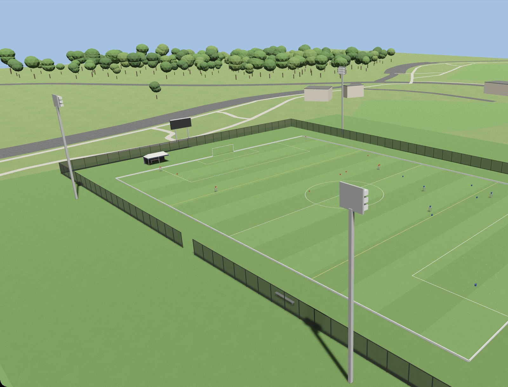

# NEXT competition practice

**TL;DR.** NEXT is Zorvane's world: the NEXT Competition 2026 field on
Field 3, West Campus, George Mason University. CrabTrapBot
is rover 0 for the Red Alliance. 99 tennis balls in each penalty box, ten orange
and ten blue buckets, some on 1 m stands. CrabTrapBot collects balls and dumps
them into its alliance's ground-level buckets, scored by rules 4. A narrated
cutscene explains the rules. Launching, tags and penalties are not modeled.



## The field, from the rules

The layout follows the *NEXT Competition 2026 Rules* (August 7, 2026):

| Rule | In the simulator |
| --- | --- |
| 2.1 Regulation soccer field, about 100 m × 64 m | 100 × 64 m pitch, FIFA Law 1 markings, yellow lines 30 yd from each end line as on the real turf |
| 2.2 Each alliance's Base is a 20 × 10 ft canopy tent | Red Base behind the south end line, Blue Base behind the north, west of each goal |
| 3.1 99 balls in each penalty box | 99 per box, seeded spread, clear of the goal area so rovers start clear |
| 3.2 10 orange and 10 blue 5-gallon buckets, ground level or 1 m | Orange (Red's targets) in the north half, blue (Blue's) in the south half; 4 per half on grey 1 m stands (the mix is a sim choice) |
| 4 Scoring | Dumps into your alliance's ground buckets score 1 or 2 points, shown as Red and Blue in the HUD; launching is not modeled |
| 4.3 out-of-bounds, 4.4 tagging, 5.6 knocked buckets | Explained in the cutscene, not enforced |

Rover 0 starts on the south goal line facing north; further rovers split across
the two goal lines. A ball dropped through an open bucket top is pulled toward
the middle of the bucket, at ground level or on a stand. `TERRA_NEXT_SEED` moves
the buckets and changes which stand (default 42).

The surroundings match the competition-day field in the NEXT2026 footage and the
mapped campus: synthetic turf, a black chain-link perimeter fence with a west
gate, four light towers, a scoreboard, the two Base tents, Field #4, the tennis
courts, West Campus Parking and the woods, all from OpenStreetMap footprints.
Everything a rover can hit has a collider. Buckets are Home Depot orange
(#F96302, with a generic white label panel instead of the store logo) and blue
(#1D5DB2, matched by eye to the footage). Balls carry optic-yellow felt with the
white seam.

## Launch

From the Zorvane repository root:

```sh
TERRA_ZENOH=0 cargo run -p zorvane
```

The intro cutscene plays first: a camera tour of the field with captions and a
voice-over of the rules. Enter skips it. `TERRA_ZENOH=0` leaves the primary rover
on the keyboard: W and S drive forward and back, A and D turn, Space stops. With
Zenoh on, a remote client drives rover 0 with `teleop`. Zenoh keys stay
`terra/rover/<id>/…`:

```sh
cargo run -p zorvane
python3 simulator/tools/zenoh_client.py --rover 0 drive --linear 0.8 --angular 0 --seconds 3
```

Headless smoke, no window, no cutscene and no Zenoh:

```sh
TERRA_HEADLESS=1 TERRA_ZENOH=0 ZORVANE_SMOKE=1 cargo run -p zorvane
```

| Variable | Effect |
| --- | --- |
| `ZORVANE_VEHICLE` | Rover body. Defaults to `crab-trap-bot`. |
| `ZORVANE_CUTSCENE=0` | Skip the intro cutscene. `scripts/run-argos-local.sh` sets it. |
| `TERRA_NEXT_LIGHTING` | `noon` (default), `overcast` or `evening`, for camera and detection data. |
| `TERRA_NEXT_BALLS` | Extra balls scattered over the pitch, on top of the 198 in the boxes. |
| `TERRA_NEXT_CAMERA=overview` | Spectator view over the west touchline instead of following rover 0. |
| `TERRA_NEXT_SEED` | Bucket layout seed (default 42). |

CrabTrapBot has an open-front collision frame. A ball entering the low intake,
including the space behind either flap, is moved into a visible holding area
inside the rover. It holds up to eight balls; at capacity the flaps stay shut
and a front bar closes the chassis, so further balls stay on the field. An upper
front guard keeps buckets outside the rover while balls still pass below it.

### Loading and dumping

Each rover shows its onboard count and state in the upper-right panel:
**SEARCHING**, **CARRYING BALLS**, **FULL: RETURN TO GOAL** or **WAITING FOR
OPERATOR**, under the Red and Blue scores.

1. Drive back to the goal you started on (even slots south, odd slots north).
   Within 1 m of the goal line, collected balls become *waiting*; the rover keeps
   driving.
2. Click **LOAD 1 INTO DUMPER**, or the rover in the 3D view, to move one waiting
   ball into the top dumper. It holds `DUMPER_CAPACITY` (2) balls, about 0.6 m up.
3. Drive into the opposing half and park against one of your alliance's
   ground-level buckets: Red dumps into orange, Blue into blue (rules 3.2b).
   **DUMP** appears once the outlet is over the bucket opening.
4. Click **DUMP**. The balls fall for real; a ball scores only when it lands in
   the bucket: 1 point, or 2 within 30 m of the opponent's Base (rules 4).

A dump from a robot parked against a bucket counts. Raised buckets are out of
dump reach: their rims, at about 1.34 m, are above the dumper, so they need a
launcher (3 or 6 points). The dump chute is idealized, and the STEP model's panel
geometry, hinge torque and ball contact with the panels are not modeled.

Startup prints a `Terra NEXT:` line with the ball and bucket counts.

### Outdoor GPS

The pitch is placed on Field 3 (below), so the bridge publishes a geographic
`localization` report and simulated GPS on `navigation/outdoor`. ARGOS shows the
rover at Field 3, and Terra's outdoor GPS navigation runs on the simulated field.

### Letting an AI model play

[`tools/zorvane_mcp.py`](tools/zorvane_mcp.py) is an MCP server that lets any
MCP client (Claude Code, Claude Desktop, or a local model behind an MCP-capable
runner) play the match as one rover. It talks to Zorvane over the same Zenoh
topics as ARGOS, so every command passes the rover's authority and safety checks.

```sh
python3 -m pip install -r simulator/tools/requirements.txt
cargo run -p zorvane                       # Zenoh on, the default
claude mcp add zorvane -- python3 simulator/tools/zorvane_mcp.py --rover 0
```

The server's instructions give the model the field frame and the scoring loop.
Its tools:

| Tool | What the model does with it |
| --- | --- |
| `get_match_state` | Score, ball counts, `can_load`/`can_dump`, pose, autonomy level, goal and proposal |
| `look` | Forward camera image (PNG) with the pose it was taken from |
| `get_map` | Occupancy map as text, north at the top |
| `set_autonomy_level` | Pick L0 `teleop` to L4 `target_search` |
| `go_to` | Waypoint goal in field metres or latitude/longitude, L3 or L2, optionally waiting for arrival |
| `drive` | Teleop burst of at most 5 s at most 2 m/s, then stop |
| `stop` | Safety stop and goal cancel |
| `load_ball`, `dump` | The NEXT LOAD and DUMP buttons |
| `answer_proposal` | Approve or reject a supervised-exploration goal |

Bucket positions are not exposed; the model has to find them with `look`.

### Rebuilding the assets

The field's models and textures are generated, not hand-edited:

```sh
python3 simulator/tools/blender/fetch_osm.py
/Applications/Blender.app/Contents/MacOS/Blender --background --factory-startup \
    --python simulator/tools/blender/build_next_assets.py -- --out simulator/assets
python3 simulator/tools/cutscene/make_voiceover.py
```

`fetch_osm.py` refreshes `mason_osm.json` (ODbL, © OpenStreetMap contributors).
`build_next_assets.py` writes the surroundings, both buckets and the turf and
ball textures; `--preview DIR` also renders reference images. The cutscene
script is `simulator/assets/cutscene/next_intro.json`; `make_voiceover.py`
speaks it with the macOS `Samantha` voice, encodes Ogg Vorbis with ffmpeg and
rewrites each beat's timing.

## Placement

The anchor is `38.833116675, -77.323160625`, the centroid of
[Field #3](https://www.openstreetmap.org/way/233194680) on West Campus, where the
NEXT 2026 rules place the competition. Its mapped long edge provides the 327.04°
heading. Placement data is © OpenStreetMap
contributors, available under the [ODbL](https://www.openstreetmap.org/copyright).
The pitch keeps the rules' 100 × 64 m dimensions rather than copying a mesh.
The default ellipsoid height is 85.13 m: independent USGS point elevation
(116.988838 m) plus NOAA GEOID18's geoid offset there (-31.856 m), rounded.
This is an approximate datum conversion and map alignment, not a field survey.

Sources: [USGS point elevation](https://epqs.nationalmap.gov/v1/json?x=-77.323160625&y=38.833116675&units=Meters&wkid=4326&includeDate=false),
[NOAA GEOID18 offset](https://geodesy.noaa.gov/api/geoid/ght?lat=38.833116675&lon=-77.323160625&model=14).

Set these before launch to use independently measured placement values:

| Variable | Meaning |
| --- | --- |
| `TERRA_GMU_LAT` | Latitude in decimal degrees |
| `TERRA_GMU_LON` | Longitude in decimal degrees |
| `TERRA_GMU_ELEVATION` | Ellipsoid height of the authored surface, metres |
| `TERRA_GMU_HEADING` | Pitch forward heading clockwise from north, 0–359.999° |

The placement sets the geographic origin and heading for simulated GPS and the
`localization` report; rover coordinates, metre scale, goal-line spawns, balls
and bucket physics stay in the pitch frame. Restart after changing it.
