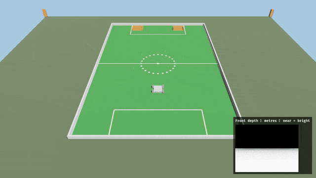

# NEXT competition practice

**TL;DR.** `TERRA_NEXT=1` loads a full soccer pitch. Zatara is rover 0 on `terra-ground`. Six tennis balls. Twenty open 5-gallon buckets. No scoring. Select `crab-trap-bot` to collect balls through its front opening.


*105 m by 68 m. Zatara starts on the south goal line, between the posts, facing the field.*



*Hold W, or send `cmd_vel`. The rover pushes balls. Buckets keep what crosses the mouth.*

Zatara starts on the south goal line, centred on the goal, facing Bevy −Z (into the field).
A second rover starts on the north goal line facing the other way. Further rovers split across the two goals and spread along the goal line.
Balls rest just north of the centre spot.
A ball dropped through an open bucket top is pulled toward the middle of the bucket.
Boards run the touchlines and stop at each goal.

The pitch is the FIFA recommended international size, 105 m by 68 m, on a 120 m square. Centre circle, penalty areas, and goal areas use the Law 1 sizes. See [SCALE.md](../SCALE.md).

## Launch

From the Zorvane repository root:

```sh
TERRA_NEXT=1 TERRA_ZENOH=0 cargo run -p zorvane
```

`TERRA_ZENOH=0` leaves the primary rover on the keyboard. W and S drive forward and back, A and D turn, and Space commands a stop. With Zenoh left on, a remote client drives Zatara as rover 0. Zenoh keys stay `terra/rover/<id>/…`:

```sh
TERRA_NEXT=1 cargo run -p zorvane
python3 simulator/tools/zenoh_client.py --rover 0 drive --linear 0.8 --angular 0 --seconds 3
```

Headless smoke, no window and no Zenoh:

```sh
TERRA_NEXT=1 TERRA_HEADLESS=1 TERRA_ZENOH=0 ZORVANE_SMOKE=1 cargo run -p zorvane
```

`TERRA_NEXT=1` turns off the practice town and Terrarium tiles and sets the ground to a 120 m square. It also takes precedence over `TERRA_MISSION=1`. `TERRA_ROVER_COUNT` still changes the fleet; on this pitch the extra rovers line up on the two goal lines. `TERRA_NEXT_SEED` moves the twenty buckets (default 42). `ZORVANE_VEHICLE` still selects the body and defaults to `terra-ground`, which is what Zatara drives. `TERRA_HEADLESS=1` runs the same scene without a window.

To practice collecting with the updated model:

```sh
TERRA_NEXT=1 TERRA_ZENOH=0 ZORVANE_VEHICLE=crab-trap-bot cargo run -p zorvane
```

The CrabTrapBot has an open-front collision frame. A ball entering the low, central intake is moved into a visible holding area inside the rover. The two simplified flap visuals swing inward as a ball approaches and return closed afterward. This is a one-way collection approximation: the STEP model's actual panel geometry, hinge torque, ball contacts with the panels, release into buckets, and scoring are not modeled. Other vehicles continue to push balls.

Startup prints a `Terra NEXT:` line with the ball and bucket counts.
