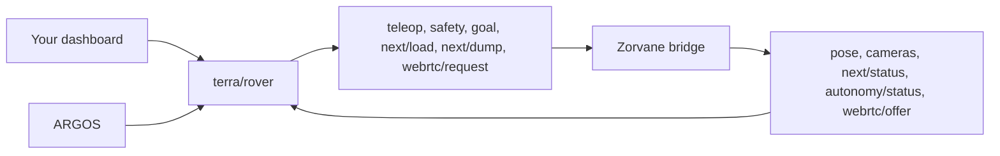
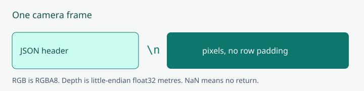

# Terra fleet, camera frames, and Zenoh control

**TL;DR.** Prefix `terra/rover`. The simulator listens on `tcp/127.0.0.1:7447`;
connect as a Zenoh client. These are the same keys a real Terra rover uses, so a
dashboard built against the simulator works against TerraPhone and ARGOS's fleet.



*Commands go in. State, frames and video come back.*

The simulator starts one rover by default. Choose an initial count from 0 through
32 with `TERRA_ROVER_COUNT`:

```sh
TERRA_ROVER_COUNT=3 cargo run -p zorvane
```

Every rover has its own physics body, differential-drive controller, odometry,
front RGB camera, depth camera, and FPV camera. Even slots start on the south
goal line for the Red Alliance, odd slots on the north for Blue. Reducing the
count removes the newest rovers. IDs start at zero, stay stable for surviving
rovers, and are never reused during a run, so they may have gaps.

The spectator camera and the depth preview follow the rover in slot zero. The
limit is `terra::MAX_ROVERS = 32`; rendering costs grow with each rover's cameras.

## Python tool

```sh
python3 -m pip install -r tools/requirements.txt
```

From the simulator directory:

```sh
python3 tools/zenoh_client.py fleet
python3 tools/zenoh_client.py fleet --count 2
python3 tools/zenoh_client.py --rover 0 frames --output /tmp/terra-frames
python3 tools/zenoh_client.py --rover 0 drive --linear 0.8 --angular 0.3 --seconds 3
python3 tools/zenoh_client.py --rover 0 goto --x -20 --y 5
python3 tools/zenoh_client.py --rover 0 goto --cancel
```

`frames` writes each rover's latest `rgb.npy` (`(height, width, 4)` uint8 sRGB
RGBA), `depth.npy` (`(height, width)` float32 axial metres, NaN for no return),
the JSON metadata and an RGB PPM. `drive` selects the `teleop` level, sends
bound `teleop` at 20 Hz, and sends a zero on completion or Ctrl-C. `goto` selects
`waypoint_direct` (or `--level waypoint`), sends one bound goal and prints
`goal/status` until `arrived`.

## Driving: bound teleop

`terra/rover/<id>/teleop` drives a rover. Each command is bound to the rover's
current run and authority revision, read from `terra/rover/<id>/autonomy/status`
(`run_id` and `revision`):

```json
{"linear":0.6,"angular":0.0,"run_id":"run-1792825168867262000","authority_revision":2,"operator_session_id":"my-dashboard","sequence":17}
```

`linear` is m/s forward, `angular` rad/s with positive turning left, both within
±5. `sequence` increases with every command. `operator_session_id` and `run_id`
are 1 to 64 characters from `[A-Za-z0-9._:-]`. Send at 10 to 20 Hz: a command
expires after 0.5 s, and wheel-speed limits and collisions still apply. A
command with an old `run_id` or `authority_revision` is ignored, so re-read
`autonomy/status` when it changes. The retired `cmd_vel` key is not accepted.

Rovers start armed. `terra/rover/<id>/hardware/status` reports `armed`, and
`terra/rover/<id>/safety` with `{"action":"stop","token":"stop-1"}` is an
emergency stop that runs after every other command received in the same tick.
A stop needs no binding. It latches until a reset, which is bound like teleop:
`{"action":"reset","token":"reset-1","run_id":"…","authority_revision":4}`.
Terra rejects a reset while localization is unhealthy; `autonomy/status` reports
`result` for the token. Holding Space in the simulator window also stops every
remote-controlled rover.

## Topics

There is no shared command topic that drives every rover. Commands for an id
that is not spawned are ignored, and every command payload must fit in 2048 bytes.

### Commands (dashboard to simulator)

| Key | Payload |
| --- | --- |
| `<id>/teleop` | Bound twist, above |
| `<id>/safety` | `{"action":"stop","token":"…"}` |
| `<id>/goal` | One go-to-waypoint goal, latched. See [Go to waypoint](#go-to-waypoint) |
| `<id>/next/load` | Any payload: move one waiting ball into the dumper |
| `<id>/next/dump` | Any payload: dump when `next/status` says `can_dump` |
| `<id>/webrtc/request`, `<id>/webrtc/answer`, `<id>/webrtc/ice/dashboard` | FPV signaling. See [FPV video](#fpv-video) |
| `fleet/size` | `{"count":3}`, 0 through 32 |
| `<id>/autonomy`, `<id>/goal/decision`, `<id>/hardware`, `<id>/navigation/settings`, `<id>/navigation/source`, `<id>/navigation/resume`, `<id>/search`, `<id>/search/action`, `<id>/search/report/ack`, `<id>/mission/report` | Terra autonomy contract, decoded by the Terra crates |

### State (simulator to dashboard)

| Key | Payload |
| --- | --- |
| `<id>/pose` | `{"x":1.0,"y":2.0,"yaw":0.3,"heading":0.3}`, about 10 Hz |
| `<id>/next/status` | NEXT state for that rover, about 5 Hz (below) |
| `next/score` | `{"schema_version":1,"red":3,"blue":0}` |
| `<id>/camera/rgb`, `<id>/camera/depth` | Frame packets, up to 10 Hz each |
| `<id>/localization` | Geographic origin of the field frame (below) |
| `<id>/navigation/outdoor` | Simulated GPS and outdoor navigation state |
| `<id>/autonomy/status` | Level, safety, `run_id`, `revision`, navigation and runtime health |
| `<id>/hardware/status` | Simulated motor relay: `armed`, `connected`, `ready`, `output_active` |
| `<id>/goal/status` | Progress for the latched goal |
| `<id>/map/occupancy`, `<id>/map/occupancy/heartbeat` | Occupancy grid from the depth camera. See [PUBLISHING.md](PUBLISHING.md) |
| `<id>/goal/proposal`, `<id>/exploration/status`, `<id>/search/status`, `<id>/search/report`, `<id>/mission/status`, `<id>/experiment/status` | Terra autonomy and run status |
| `<id>/objects` | Buckets and balls from the shared YOLO detector: local `x`/`y`, class, colour, sightings, `confirmed`. Same body as TerraPhone |
| `<id>/webrtc/offer`, `<id>/webrtc/ice/phone`, `<id>/webrtc/state` | FPV signaling |
| `fleet/state` | `{"count":3,"max_count":32,"ids":[0,1,2]}`, on change and every second |

Keys are relative to the prefix: `<id>/pose` is `terra/rover/0/pose` for rover 0.

### NEXT status

```json
{"schema_version":1,"alliance":"red","target_bucket":"orange","state":"CARRYING BALLS","collected":3,"waiting":0,"dumper":0,"capacity":8,"dumper_capacity":2,"can_load":false,"can_dump":false}
```

`state` is `SEARCHING`, `CARRYING BALLS`, `FULL: RETURN TO GOAL` or `WAITING FOR
OPERATOR`. Balls in the intake are `collected`; back at the rover's own goal
line they become `waiting`; `next/load` moves one into the `dumper`. `can_dump`
is true while the dumper holds a ball and the outlet is over one of the
alliance's ground-level buckets. The rules are in [NEXT.md](NEXT.md#loading-and-dumping).

### Localization

```json
{"version":1,"mode":"geographic","originLatitude":38.833116675,"originLongitude":-77.323160625,"anchorX":0.0,"anchorY":0.0,"rotation":-5.708,"simulated":true}
```

The field frame's origin is the centre spot of Field 3. `rotation` is the
negative pitch heading in radians.

## Go to waypoint

One message on `terra/rover/<id>/goal` sets a goal; Terra does not need it
repeated. The follower is Terra's `terra-waypoint` crate, the same one TerraPhone
runs. Holding Space zeros the wheels and leaves the goal latched.

A goal needs a waypoint autonomy level. Rovers start in `teleop`, so first
request one on `terra/rover/<id>/autonomy`, bound like teleop:

```json
{"level":"waypoint_direct","token":"level-1","run_id":"run-1792825168867262000","authority_revision":2}
```

`waypoint_direct` drives straight at the goal. `waypoint` routes with A* over
cells the depth camera has observed, and holds with `route_no_path` while the
way ahead is still unknown. Request `teleop` again to drive by hand.

The goal body is one of these objects, plus the same `run_id` and
`authority_revision`:

```json
{"frame":"local","x":-20.0,"y":5.0,"run_id":"…","authority_revision":3}
{"frame":"local","x":-20.0,"y":5.0,"yaw":0.4,"token":"goal-1","run_id":"…","authority_revision":3}
{"frame":"wgs84","latitude":38.83325,"longitude":-77.32321,"run_id":"…","authority_revision":3}
{"cancel":true}
```

A cancel needs no binding. Watch `result` for your token in `autonomy/status`:
an unbound goal, or one sent in `teleop`, is `rejected`.

`x` and `y` are metres in the same robotics frame as depth `body`: `x` is
`-Bevy Z`, `y` is `-Bevy X`, and yaw 0 faces +x, toward the north goal. The
origin is the centre spot; rover 0 starts near `(-49.6, 0)` on the south goal
line. Optional `yaw`
is radians in `[-2π, 2π]` and is the heading to hold after the position is
reached. Optional `token` is 1 to 64 characters from `[A-Za-z0-9._:-]` and is
echoed so a client can correlate a goal. `wgs84` goals use the Field 3
placement ([NEXT.md](NEXT.md#placement)); Terra converts them into local metres. Targets outside the
ground square (one metre inside the edge) are ignored and do not replace the
current goal. Commands for an id that is not spawned are ignored.

Terra publishes `terra/rover/<id>/goal/status` when the state changes and a few
times a second while a goal is active:

```json
{"state":"active","goal_id":4,"token":"goal-1","distance":6.2,"x":-20.0,"y":5.0,"yaw":0.4}
```

`state` is `idle`, `active`, or `arrived`. `goal_id` increases for each accepted
goal and is `0` when idle. `latitude` and `longitude` are the goal that was
sent. `x` and `y` are that same goal after the tangent-plane projection
(`x` north, `y` west), not the rover pose. `distance` is the remaining
horizontal metres. `token`, `yaw`, `latitude`, and `longitude` are omitted when
the goal did not set them. Arrival is within 0.75 m, and
within about 0.12 rad when a final yaw was set. The follower slows inside 3 m,
turns in place when the heading error is large, and writes a body twist into
the existing velocity loop. It does not plan around obstacles; the chassis
stops on Avian collisions.

## FPV video

Each rover answers a dashboard's WebRTC call with H.264 video, 640 × 480 at
15 fps, from a camera on its front sensor mount. Signaling is Terra's
`fpv-signaling` contract, the same one TerraPhone and ARGOS use, on six keys under
`<prefix>/<id>/webrtc/`. Every message is JSON with `"v":1` and a UUID `session`:

1. The dashboard publishes `request` `{"v":1,"session":"…","action":"start"}`.
2. The rover publishes `offer` `{"v":1,"session":"…","sdp":"…"}` and trickles
   `ice/phone` `{"v":1,"session":"…","candidate":"…","sdpMid":"0","sdpMLineIndex":0}`.
3. The dashboard publishes `answer` with its SDP and its own `ice/dashboard`
   candidates. An empty `candidate` ends gathering.
4. The rover publishes `state`: `connecting`, `connected`, `failed` or `closed`.
5. `request` with `"action":"stop"` ends the call.

ICE is host-only by default. `ZORVANE_FPV_STUN` adds comma-separated STUN
servers, and `ZORVANE_FPV=0` turns video off. The camera renders only while a
call is live.



*UTF-8 JSON, one newline, then contiguous pixels.*

A frame packet is a UTF-8 JSON header, a single newline byte, then contiguous
pixel bytes. The header contains:

```json
{"rover_id":0,"version":1,"width":256,"height":192,"sequence":12,"received_at":2.5,"encoding":"32FC1_LE","vertical_fov":1.0471976,"near":0.05,"far":30.0,"exposure_time":2.4,"camera":{"x":0.3,"y":0.0,"z":0.4,"qx":0.0,"qy":0.0,"qz":0.0,"qw":1.0},"body":{"x":0.0,"y":0.0,"yaw":0.0}}
```

`exposure_time`, `camera`, and `body` are present on depth packets that were paired with a GPU exposure. They are omitted otherwise, including every RGB packet. Version stays 1; older clients ignore the extra fields. `camera` is the optical pose (X right, Y down, Z forward) in the robotics world, Z up, using the same Bevy conversion as the simulator’s local occupancy map. `body` is the rover origin in that frame and the yaw of body forward, sampled with the camera at exposure time. This is not an occupancy-grid topic. A phone or other client integrates the depth image itself.

Pixels are row-major, starting at the top left, without GPU row padding. Depth
uses one little-endian float32 per pixel. RGB uses four uint8 channels per pixel.
Dimensions and lens parameters come from each rover's depth-camera configuration.
For pixel centres `(u + 0.5, v + 0.5)`, the pinhole focal length in pixels is
`fx = fy = height / (2 * tan(vertical_fov / 2))`, with principal point
`(width / 2, height / 2)`. `terra-mapping` addresses integer pixels, so the phone
decoder passes principal point `(width / 2 - 0.5, height / 2 - 0.5)`, matching
the simulator’s own occupancy integration.

RGB and depth cameras share their pose, resolution, and projection, but GPU
readbacks complete independently. Sequences are per-camera readback counters;
matching sequence numbers do not guarantee matching exposures. `received_at` is
CPU receipt time in seconds since the simulation started, not exposure time.
This interface does not promise synchronized RGB-D pairs.

Frames publish at up to 10 Hz per stream per rover, with only the latest unsent
frame retained. Older unsent frames are replaced, and congestion may drop frames.
At the default 256×192 resolution, the two raw streams total about 3.75 MiB/s per
rover before protocol overhead. Rendering/readback rates depend on the GPU and
fleet size.

## Configuration

| Environment variable | Purpose |
| --- | --- |
| `TERRA_ROVER_COUNT` | Initial count, default 1 |
| `TERRA_ZENOH` | Set to `0` to disable the bridge and drive rover 0 with W/A/S/D |
| `TERRA_ZENOH_LISTEN` | Listener endpoint, default `tcp/127.0.0.1:7447` |
| `TERRA_ZENOH_PREFIX` | Topic prefix, default `terra/rover` |
| `TERRA_ZENOH_CONFIG` | Full Zenoh JSON5 configuration file; replaces the default session configuration |
| `TERRA_RUN_DIR` | Run logs as JSONL, default `runs` |
| `ZORVANE_FPV`, `ZORVANE_FPV_STUN` | FPV video, above |
| `ZORVANE_OBJECTS` | Set to `0` to turn off bucket and ball detection |

For a dashboard on another computer, set the listener to `tcp/0.0.0.0:7447` and
connect to `tcp/SIMULATOR_IP:7447`. Restart after correcting a session startup
error; the bridge logs errors and keeps remote drive commands stopped.

Other Bevy systems can change the fleet with `ResMut<RoverFleet>::set_count(n)`.
Query rover entities with `(With<Rover>, &RoverId)`; `DriveCommand` and
`Odometry` are per-rover components. Camera entities also carry `RoverId`, with
`RgbFrame` or `DepthFrame`. Camera resolution, field of view and range use
`DepthCameraConfig`.

## Verification

Ordinary tests: `cargo test`. Graphics and networking checks:

```sh
cargo test -- --include-ignored --test-threads=1
TERRA_ZENOH_TEST_PYTHON=python3 cargo test zenoh_round_trip -- --ignored --test-threads=1
python3 -m unittest discover -s tools -p 'test_*.py'
cargo clippy --all-targets -- -D warnings
```

The optional Python test uses the installed Zenoh and NumPy packages. Tests cover
live resizing, ID retirement, command isolation, timeout stopping, RGB/depth
payload decoding, real TCP sessions, and two simultaneous GPU camera pairs with
cleanup after a rover is removed.

## iOS client

TerraPhone can publish velocity commands directly to this bridge and build a local occupancy map from the depth stream. Configure the endpoint and rover ID in the app’s **Bevy simulator · Zenoh** section. Use localhost in iOS Simulator or the Mac’s LAN address on a physical phone; for LAN access bind this simulator to `tcp/0.0.0.0:7447`. Phone setup lives in Terra: [mobile control](https://github.com/Super-Yojan/Terra/blob/main/docs/MOBILE_CONTROL.md) and the [Terra docs](https://super-yojan.dev/Terra/). The app refreshes a leased Rust publisher, sends at 20 Hz, and sends zero when stopped or backgrounded. While connected it subscribes to `terra/rover/<id>/camera/depth`, keeps the latest posed frame, and integrates it with `MobileOccupancyMap`. The on-screen grid is phone-local. This bridge already publishes fleet state, RGB, and `map/occupancy`. TerraPhone consuming fleet state, RGB, and that occupancy snapshot is follow-up work in Terra.
